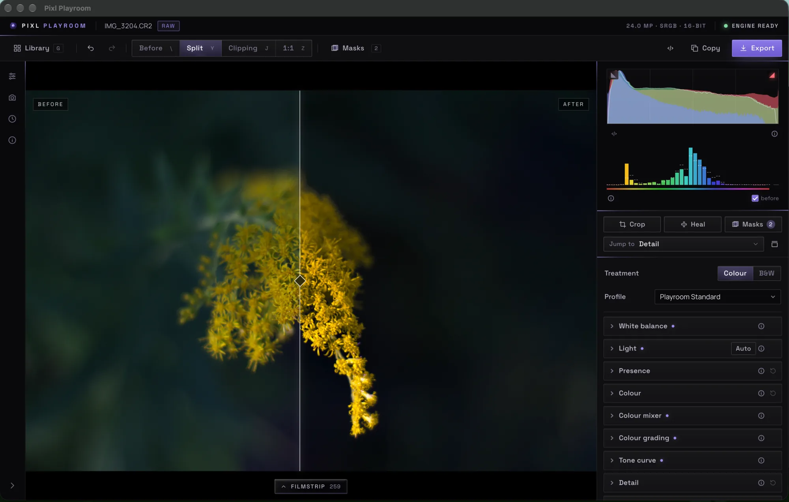

<div align="center">

<picture>
  <source media="(prefers-color-scheme: dark)" srcset="docs/readme/logo-dark.svg"/>
  
</picture>

**Develop everything. Rent nothing.**

<a href="https://github.com/xuckless/pixl-playroom/releases"></a>  <a href="#license"></a> 

[playroom.pixlfoundation.com](https://playroom.pixlfoundation.com) · [Features](docs/features.md) · [Keys](docs/keys.md) · [How it fits together](docs/architecture.md) · [Releases](https://github.com/xuckless/pixl-playroom/releases)

<br/>



</div>

A RAW photo developer for macOS and Windows: masks, looks, colour grading, AI noise reduction and super-resolution, working on the folders you already have. Free during the beta.

## Every frame is a real render

What you see is the [PIXL engine](https://engine.pixlfoundation.com)'s render of your photo with its recipe, through the same compiler an export uses. The histogram measures exactly what is shown.



## Your folders, as they are

No import and no catalogue. The original is never written: your edit lives in a sidecar beside it, and titles and keywords go into a standard `.xmp` file other apps read too.



## What's inside

- **Develop:** every Lightroom-style card from white balance to detail, PIXL's camera profiles for 46 bodies, 306 looks, curves, the colour mixer and colour grading.
- **Masks:** Subject, Background, Objects (click, box or scribble), Sky, People and their parts, brushes and gradients, joined by add, subtract and intersect.
- **AI:** denoise, deblur, JPEG restore and super-resolution. Models download on demand and run on your computer.
- **Library:** ratings, flags, labels, smart collections, stacks, duplicates, virtual copies and batch export.
- **HDR:** gain maps read and written, and HDR editing on a display with headroom.

Every card and tool, with the engine operation behind it: [docs/features.md](docs/features.md)

## Install

Download the latest beta for macOS 15+ (Apple silicon or Intel) or Windows 10+ (64-bit) from [playroom.pixlfoundation.com](https://playroom.pixlfoundation.com). Playroom updates itself on the stable or beta channel (Settings → Updates).

## Develop

```sh
pnpm install             # needs a read:packages token for the engine (.github/RELEASING.md)
pnpm dev                 # the app; pnpm dev -- /path/to/photo.CR2 opens a photo
pnpm test && pnpm typecheck && pnpm lint && pnpm build
```

The engine is `@xuckless/pixl-engine`, a closed package of compiled binaries, so a build needs access to it. Automation, model mirrors and development kits: [docs/development.md](docs/development.md). The project file format: [docs/pixl-format.md](docs/pixl-format.md). Planned work: [TODO.md](TODO.md).

## License

Pixl Playroom's source is [Apache-2.0](LICENSE) (see [NOTICE](NOTICE)). The PIXL engine it loads at run time is a separate, closed-source component, distributed only as compiled binaries; it is not covered by this licence and is not available through this repository. Third-party components are listed in [build/THIRD_PARTY_NOTICES.txt](build/THIRD_PARTY_NOTICES.txt).
